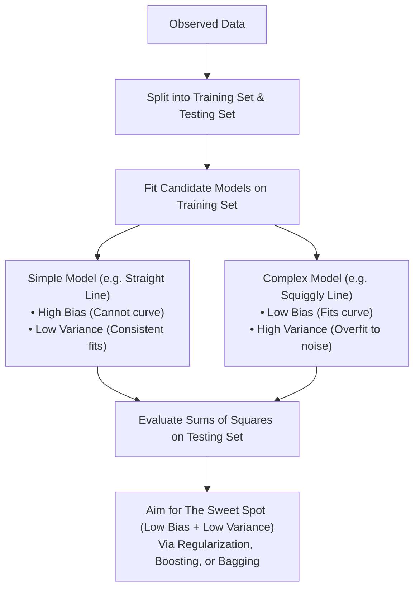

# Bias and Variance

> **Summary**: Bias is the inability of a machine learning model to capture the true underlying relationship in data, while variance is the difference in fits and performance across distinct datasets. Finding the "sweet spot" between a simple model (high bias, low variance) and a complex model (low bias, high variance) is essential for consistent generalization.

---

## 1. Core Technique Taught

### Overview & Concepts
- **Problem Setup**: Using mouse weight to predict mouse height. While light mice are short and heavier mice are taller, past a certain weight mice become obese without growing taller, creating an arched/curved true relationship.
- **Dataset Partitioning**: The data is split into a **training set** (used to fit the algorithms) and a **testing set** (used to evaluate generalization).
- **Comparison of Two Model Extremes**:
  1. **Linear Regression (Least Squares / Straight Line)**:
     - Constrained to a straight line; incapable of replicating curved relationships.
     - **High Bias**: Inability to capture the true underlying arc, no matter how well fitted to training data.
     - **Low Variance**: Yields very similar sums of squares across training and testing sets, providing consistent (even if imperfect) predictions.
  2. **Complex Flexible Model ("Squiggly Line")**:
     - Hugs the training data points along the arc.
     - **Low Bias**: Fully capable of adapting to the curve in the training data.
     - **High Variance**: Produces vastly different sums of squares across different datasets; unpredictable and unstable on future unseen data.
- **Evaluation Metric (Sums of Squares)**: Measures distances from the fitted line to the data points, squared so negative distances do not cancel positive ones, and summed.
  - On the **training set**, the squiggly line wins (sum of squares = 0).
  - On the **testing set**, the straight line wins; the squiggly line performs poorly.
- **Key Terminology Defined**:
  - **Bias**: The inability of a machine learning method to capture the true relationship.
  - **Variance**: The difference in fits between different datasets.
  - **Overfit**: When a model fits the training set really well, but fails on the testing set.
- **The Ideal Algorithm ("The Sweet Spot")**:
  - Combines low bias (accurately models the true relationship) with low variability (produces consistent predictions across datasets).
  - Lies in the sweet spot between an overly simple model and an overly complicated model.
- **Three Common Methods to Reach the Sweet Spot**:
  1. **Regularization**
  2. **Boosting**
  3. **Bagging** (e.g., Random Forests)

### Conceptual Workflow

---

## 2. Code Patterns Shown

No code shown in this video — conceptual explanation only.

---

## 3. Key Warnings & Gotchas

- **Evaluating Only on Training Data**: Measuring sums of squares solely on the training set is misleading. The squiggly line scored a sum of squares of zero on the training set, but performed terribly when evaluated against the testing set.
- **Underfitting due to High Bias**: A model that lacks flexibility (such as linear regression on a curved relationship) will never capture the true relationship, regardless of how well it is optimized on the training data.
- **Overfitting due to High Variance**: A model with too much flexibility can fit the training set exceptionally well while failing to generalize to future datasets, making performance unpredictable across different samples.
