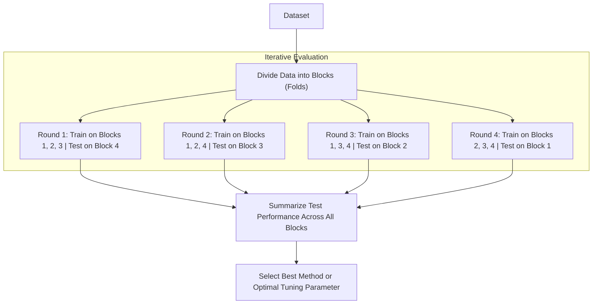

# Cross-Validation

> **Summary**: Cross-validation allows practitioners to compare different machine learning methods and tune parameters by dividing data into blocks, iteratively training on all blocks except one, and testing on the remaining block so every block is evaluated once.

---

## 1. Core Technique Taught

### Overview & Concepts
- **Problem Setup**: Given data with variables (e.g., chest pain, blood circulation) to predict an outcome (e.g., heart disease), practitioners must decide which machine learning method to use (e.g., Logistic Regression vs. K-Nearest Neighbors vs. Support Vector Machines).
- **Two Necessary Steps**:
  1. **Training the Algorithm**: Estimating the parameters of the machine learning method using data (e.g., estimating the shape of the curve in logistic regression).
  2. **Testing the Algorithm**: Evaluating how well the machine learning method works at categorizing new data.
- **Why Cross-Validation is Used**: Instead of choosing an arbitrary block for testing (such as using the first 75% for training and the last 25% for testing), cross-validation uses all blocks one at a time for testing and summarizes the results at the end.
- **Step-by-Step Mechanism**:
  1. Divide the dataset into equal blocks (e.g., 4 blocks in 4-fold cross-validation).
  2. Train the algorithm on 3 blocks and test on the remaining block, recording performance.
  3. Rotate through the combinations so each block is used once as the test block.
  4. Compare the performance across different candidate methods (in the video example, Support Vector Machine performed best).
- **Variations Discussed**:
  - **4-Fold Cross-Validation**: Dividing data into 4 blocks.
  - **10-Fold Cross-Validation**: Dividing data into 10 blocks; noted as being very common in practice.
  - **Leave-One-Out Cross-Validation**: An extreme case where each individual patient (or sample) is treated as a block and tested individually.
- **Tuning Parameters**: Used to determine optimal values for parameters that are not estimated directly from the data but are "just sort of guessed" (e.g., the tuning parameter in Ridge Regression).

### Workflow Diagram

---

## 2. Code Patterns Shown

No code shown in this video — conceptual explanation only.

---

## 3. Key Warnings & Gotchas

- **Reusing Training Data for Testing**: A "terrible approach" is to use all data to estimate parameters (train) and then test on that same data. We must evaluate how the method performs on data it was not trained on.
- **Arbitrary Single-Split Vulnerability**: Using a fixed split (such as the first 75% for training and the last 25% for testing) introduces uncertainty, as there is no guarantee that using the first 75% was the best way to divide the data.
- **Tuning Parameters Cannot Be Directly Estimated**: Parameters like the tuning parameter in Ridge Regression cannot be estimated directly from the data like model parameters; they require cross-validation across guesses to find the best value.
