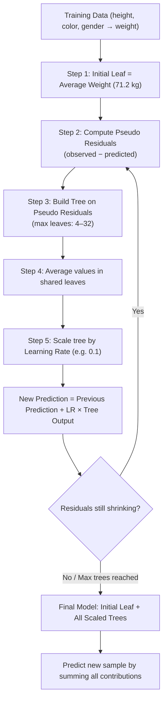

# Gradient Boost Part 1 — Regression Main Ideas

> **Summary**: Gradient boosting for regression starts with a single leaf (the average of the target variable) and iteratively adds fixed-size trees trained on the pseudo residuals (differences between observed and predicted values). Each tree's contribution is scaled down by a learning rate, so the algorithm takes many small steps in the right direction — reducing variance at the cost of a slightly worse training fit.

---

## 1. Core Technique Taught

### Overview & Concepts

- **Use case framing**: The video uses a six-person training dataset with features height, favorite color, and gender to predict continuous weight — an explicit regression task. "Gradient boost for regression is different from doing linear regression."
- **Prerequisites stated by speaker**: Understanding of decision trees, AdaBoost, and bias-variance trade-off are assumed.

#### Comparison with AdaBoost
The speaker explicitly contrasts the two algorithms:

| | AdaBoost | Gradient Boost |
|---|---|---|
| First step | Builds a short stump | Builds a single **leaf** (average of target) |
| Tree size | Stumps only | Larger trees, restricted to a max number of leaves |
| Scaling | Each stump has its own "amount of say" | **All trees scaled by the same learning rate** |
| Error basis | Next stump based on previous stump's errors | Next tree based on pseudo residuals from all previous trees |

#### Step-by-Step Algorithm (as described in the video)

1. **Initial leaf**: Calculate the average of the target variable (e.g., average weight = 71.2 kg). This is the first prediction for every sample.
2. **Compute pseudo residuals**: For each sample, calculate `observed value − predicted value`. The speaker calls these "pseudo residuals" — "pseudo" to distinguish from linear regression residuals (explained more in Part 2).
3. **Build a tree on the pseudo residuals**: Use the input features (height, favorite color, gender) to predict the pseudo residuals — not the original target. The tree is restricted to a maximum number of leaves (4 in the example; "in practice, people often set the maximum number of leaves to be between 8 and 32").
4. **Average leaf values**: When multiple samples land in the same leaf, replace residuals with their average.
5. **Scale by learning rate**: The new tree's contribution is multiplied by the learning rate (0.1 in the example). New prediction = `71.2 + 0.1 × 16.8 = 72.9`.
6. **Compute new pseudo residuals** from the updated prediction and repeat from step 3.
7. **Stop** when the maximum number of trees is reached or additional trees fail to significantly reduce residuals.
8. **Predict on new data**: Start with the initial leaf value, then add each tree's scaled output in sequence.

#### Learning Rate intuition (speaker's words)
> "According to the dude that invented gradient boost, Jerome Friedman, empirical evidence shows that taking lots of small steps in the right direction results in better predictions with a testing data set, i.e. lower variance."

### Workflow Diagram

---

## 2. Code Patterns Shown

No code shown in this video — conceptual explanation only.

---

## 3. Key Warnings & Gotchas

- **Gradient boost regression ≠ linear regression**: The speaker explicitly warns: "While the two methods are related, don't get them confused with each other."
- **Without a learning rate, the model overfits immediately**: In the example, adding a single tree without a learning rate predicted the exact training weight (88 kg observed = 88 kg predicted). The speaker calls this out: "The model fits the training data too well. In other words, we have low bias, but probably very high variance." The learning rate is what prevents this.
- **"Pseudo" residual naming**: The term pseudo residual distinguishes these differences from linear regression residuals. The mathematical justification is explicitly deferred to Part 2.
- **Tree size restriction is intentional**: Restricting leaves (4 in the example, 8–32 in practice) is a deliberate design choice — it causes multiple samples to share leaves, so leaf values are averaged, which acts as a regularizer.
- **All trees use the same learning rate**: Unlike AdaBoost where each stump has its own "amount of say," gradient boost applies one uniform learning rate to every tree.
