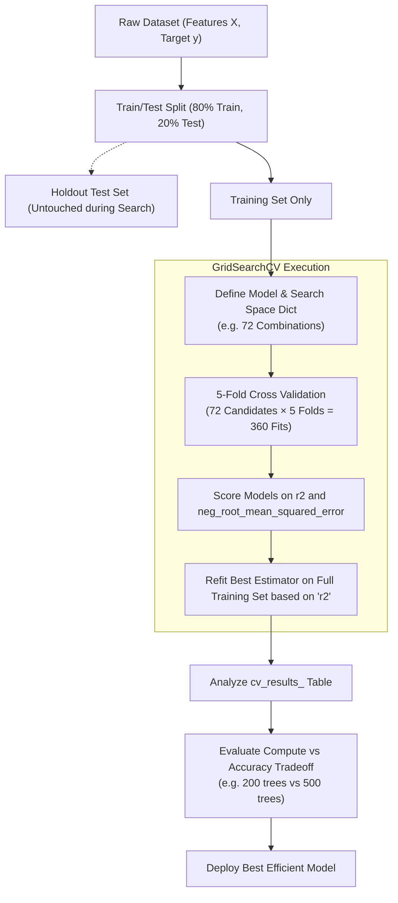

# GridSearchCV Hyperparameter Tuning

> **Summary**: `GridSearchCV` exhaustively searches a discrete multi-parameter dictionary using cross-validation on the training set to identify optimal model parameters. Evaluating the detailed cross-validation results table allows practitioners to weigh marginal accuracy gains against computational efficiency (e.g., choosing fewer trees when performance differences are negligible).

---

## 1. Core Technique Taught

### Overview & Concepts
- **Problem Formulation**: Concrete mixture dataset (Kaggle), predicting continuous concrete compressive `strength` based on mixture ingredients (cement, blast furnace slag, fly ash, water, etc.) using an XGBoost Regressor (`XGBRegressor`).
- **Strict Data Splitting Requirement**:
  - The dataset must be split into training and testing sets (using `train_test_split` with `test_size=0.20`).
  - **Grid search must be performed exclusively on the training set**. The test set must remain untouched during hyperparameter search to avoid tuning parameters to the test data.
- **Search Space Construction**:
  - Defined as a Python dictionary where keys are model hyperparameter names and values are lists of candidate settings.
  - Multiplicative Combinations: With 3 choices for `n_estimators`, 3 choices for `max_depth`, 2 choices for `gamma`, and 4 choices for `learning_rate`, the total candidate models evaluated is \(3 \times 3 \times 2 \times 4 = 72\) models.
  - With 5-fold cross-validation (`cv=5`), the search trains \(72 \times 5 = 360\) total models.
- **Multi-Metric Scoring & Refitting**:
  - Supports multiple evaluation metrics simultaneously (e.g., `r2` and `neg_root_mean_squared_error`).
  - The `refit` parameter designates which primary metric determines the single best model returned by the search object.
- **Result Analysis & Model Efficiency Analysis**:
  - In addition to extracting `best_params_`, `best_score_`, and `best_estimator_`, practitioners should export `cv_results_` into a DataFrame/CSV to compare competitive configurations.
  - **Computation vs. Gain Tradeoff**: In the demonstration, the top model (500 trees) achieved \(R^2 = 0.9228\), while the second-best model (200 trees) achieved \(R^2 = 0.92218\). Using 300 additional trees consumes substantially more compute for a negligible \(R^2\) gain (\(\sim 0.0006\)), making the 200-tree model the more practical and efficient choice.

### Workflow Diagram



---

## 2. Code Patterns Shown

The following code patterns and workflow were explicitly demonstrated in the video:

### 1. Data Preparation and Train/Test Split
```python
import numpy as np
import pandas as pd
from sklearn.model_selection import train_test_split

# Load dataset and extract feature matrix and target
df = pd.read_csv("concrete_data.csv")
X = df.drop("strength", axis=1)
y = df["strength"]

# Reshape target vector for scikit-learn models
y = np.array(y).reshape(-1, 1)

# Split into train and test sets (grid search runs strictly on train set)
X_train, X_test, y_train, y_test = train_test_split(X, y, test_size=0.20, random_state=42)
```

### 2. Base Model and Search Space Definition
```python
import xgboost as xgb

# Define base estimator with fixed random_state and no tuned parameters
base_model = xgb.XGBRegressor(random_state=42)

# Define search space dictionary (3 * 3 * 2 * 4 = 72 combinations)
search_space = {
    "n_estimators": [100, 200, 500],
    "max_depth": [3, 5, 7],
    "gamma": [0.1, 0.2],
    "learning_rate": [0.01, 0.05, 0.1, 0.2]
}
```

### 3. GridSearchCV Configuration, Fitting, and Extraction
```python
from sklearn.model_selection import GridSearchCV

# Instantiate GridSearchCV with multiple metrics and 5-fold CV
gs = GridSearchCV(
    estimator=base_model,
    param_grid=search_space,
    scoring=["r2", "neg_root_mean_squared_error"],
    refit="r2",
    cv=5,
    verbose=4
)

# Fit on training data only
gs.fit(X_train, y_train)

# Extract best results
print("Best Estimator:", gs.best_estimator_)
print("Best Parameters:", gs.best_params_)
print("Best Score (R2):", gs.best_score_)
```

### 4. Analyzing Detailed CV Results for Model Efficiency
```python
# Convert cv_results_ dictionary into a DataFrame and sort by rank/score
results_df = pd.DataFrame(gs.cv_results_)
results_df = results_df.sort_values(by="rank_test_r2")
results_df.to_csv("grid_search_results.csv", index=False)

# Compare top performers to evaluate compute power vs marginal accuracy gains
# (e.g. 500 trees @ R2=0.9228 vs 200 trees @ R2=0.92218)
```

---

## 3. Key Warnings & Gotchas

- **Never Include the Test Set in Grid Search**: Grid search must be executed strictly on the training set. Exposing test data to hyperparameter optimization causes data leakage and invalidates subsequent performance evaluation.
- **Computation Power vs. Marginal Improvement**: Do not blindly select `best_estimator_` based solely on the highest metric score. If a model with 500 trees achieves \(R^2 = 0.9228\) while a 200-tree model achieves \(R^2 = 0.92218\), the 300 additional trees consume significant computational resources for virtually no practical gain.
- **Negative Error Metrics in Scikit-Learn**: In scikit-learn, error metrics like RMSE are framed as negative values (`neg_root_mean_squared_error`) so that maximization logic remains uniform across all scoring metrics.
- **Multi-Metric Refit Requirement**: When passing a list or dictionary of multiple scoring metrics, `refit` must be explicitly specified (e.g., `refit="r2"`) to tell `GridSearchCV` which metric to optimize when building the final `best_estimator_`.
