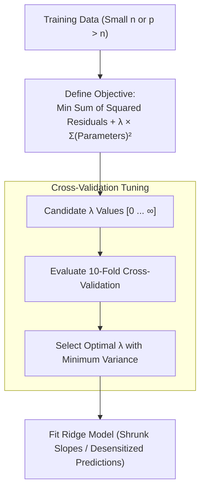

# Regularization: Ridge (L2) Regression

> **Summary**: Ridge regression (L2 regularization) adds a penalty proportional to the square of model parameters to the optimization objective, introducing a small amount of bias to dramatically reduce variance and desensitize predictions against small sample sizes and high-dimensional features (\(p > n\)).

---

## 1. Core Technique Taught

### Overview & Concepts
- **The Core Problem**: When sample sizes are small, ordinary least squares (linear regression) fits the training points too closely (zero training residuals), resulting in steep slopes that are overfit and have high variance on test data.
- **The Ridge Principle (Bias-Variance Tradeoff)**: Ridge regression introduces a small amount of bias into the training fit to achieve a significant drop in variance. Starting with a slightly worse training fit leads to superior, consistent predictions on unseen test data.
- **Mathematical Optimization Function**:
  - Rather than solely minimizing the sum of squared residuals, Ridge regression minimizes:
    \[ \text{Sum of Squared Residuals} + \lambda \times (\text{slope})^2 \]
  - For models with multiple variables, it minimizes:
    \[ \text{Sum of Squared Residuals} + \lambda \sum (\text{parameter}_i)^2 \]
    for **all parameters except the Y-intercept**.
- **Why Exclude the Y-Intercept?**: Every parameter except the Y-intercept is scaled directly by measurement data. The Y-intercept represents the baseline average response and should not be regularized.
- **The Penalty Parameter (\(\lambda\))**:
  - Can range from \(0\) to \(+\infty\).
  - When \(\lambda = 0\): the penalty term is zero, yielding the exact ordinary least squares solution.
  - As \(\lambda\) increases: slopes and feature weights shrink asymptotically towards zero, desensitizing predictions to fluctuations in input features.
  - **Selecting \(\lambda\)**: \(\lambda\) is selected by testing candidate values using **10-fold cross-validation** to identify the value that yields the lowest variance.
- **Applicability Across Model Types**:
  - **Continuous Features**: Predicts mouse size based on continuous weight measurements.
  - **Discrete Features**: Predicts mouse size using categorical variables (e.g., normal diet vs. high-fat diet), where the difference term is penalized by \(\lambda \times (\text{diet difference})^2\).
  - **Logistic Regression**: Penalizes the slope parameters in log-odds space by optimizing the sum of likelihoods (via maximum likelihood) plus the L2 penalty.
- **Solving the "Unsolvable" High-Dimensional Problem (\(p > n\))**:
  - In ordinary least squares, estimating \(p\) parameters requires at least \(p\) data points. When \(p > n\) (e.g., 10,000 gene expression measurements on only 500 mice), infinitely many lines/planes fit the data with zero residual error, leaving least squares unable to select a solution.
  - Ridge regression adds the L2 penalty to establish a unique, stable solution for all 10,000+ parameters even when the sample size \(n\) is vastly smaller than the parameter count.

### Workflow Diagram

---

## 2. Code Patterns Shown

No code shown in this video — conceptual explanation only.

---

## 3. Key Warnings & Gotchas

- **Overfitting from Small Sample Sizes**: Fitting least squares to minimal data points yields zero training residuals but high variance on test data.
- **Parameter Sensitivity from Steep Slopes**: Steep slopes cause model predictions to change drastically in response to minor fluctuations in feature inputs. Ridge penalizes slope magnitude to ensure desensitized predictions.
- **Never Regularize the Y-Intercept**: Including the Y-intercept in the L2 penalty distorts the baseline prediction; only feature-associated parameters should be penalized.
- **Asymptotic Shrinkage**: Ridge regression shrinks parameters asymptotically towards zero as \(\lambda\) increases, but it never sets parameters to absolute zero (it does not perform feature selection).
- **\(\lambda\) Cannot Be Estimated Directly**: The regularization parameter \(\lambda\) cannot be solved mathematically from the training data; it must be tuned via cross-validation.
