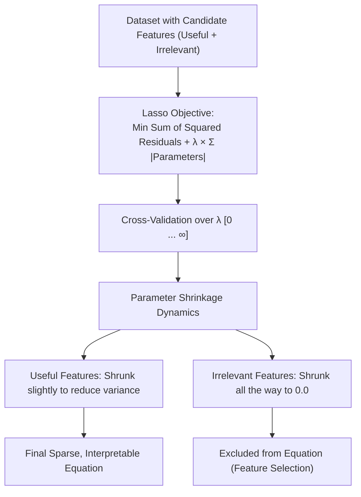

# Regularization: Lasso (L1) Regression

> **Summary**: Lasso regression (L1 regularization) adds a penalty proportional to the absolute value of the parameters (\(\lambda \sum |\beta_i|\)) to the loss function. Unlike Ridge regression, Lasso can shrink parameter coefficients all the way to zero, automatically eliminating useless variables to produce simpler, sparser, and more interpretable models.

---

## 1. Core Technique Taught

### Overview & Concepts
- **Formulation**: Minimizes the sum of squared residuals plus the Lasso penalty:
  \[ \text{Sum of Squared Residuals} + \lambda \sum |\text{parameter}_i| \]
  for **all estimated parameters except the Y-intercept**.
- **The Penalty Parameter (\(\lambda\))**:
  - Ranges from \(0\) to \(+\infty\), optimized using cross-validation.
  - When \(\lambda = 0\): identical to ordinary least squares.
  - As \(\lambda\) increases: parameters shrink, reducing variance at the cost of a small amount of bias.
- **Comparison: Ridge (L2) vs. Lasso (L1)**:
  - **Penalty Shape**: Ridge squares the parameters (\(\lambda \times \text{slope}^2\)); Lasso takes the absolute value (\(\lambda \times |\text{slope}|\)).
  - **Asymptotic vs. Exact Zero**:
    - **Ridge**: Can only shrink parameters asymptotically close to zero. Variables are retained in the model regardless of how large \(\lambda\) becomes.
    - **Lasso**: Can shrink parameters **all the way to absolute zero**, completely eliminating them from the final equation.
- **Variable Selection & Sparsity**:
  - In models with noisy or irrelevant features (e.g., predicting mouse size using weight and diet along with irrelevant features like astrological sign or swallow airspeed), Lasso sets coefficients for the useless variables to zero.
  - Generates simpler, cleaner, and more interpretable equations that only retain truly predictive features.
- **Decision Rule (When to Use Ridge vs. Lasso)**:
  - **Lasso is preferred**: When the dataset contains a large number of useless or uninformative variables, because it performs automatic feature elimination to lower variance.
  - **Ridge is preferred**: When most variables in the dataset are genuinely useful and contribute to the prediction.

### Architectural Workflow

---

## 2. Code Patterns Shown

No code shown in this video — conceptual explanation only.

---

## 3. Key Warnings & Gotchas

- **Do Not Penalize the Y-Intercept**: Just like Ridge regression, the Y-intercept represents baseline central tendency and is not scaled by measurements; it must never be regularized in the penalty term.
- **Model Choice Depends on Feature Relevance**: Lasso is not universally superior to Ridge. If the dataset's features are mostly useful, Ridge regression typically provides better predictions. Lasso excels when the dataset has many useless variables that introduce noise.
- **Differential Shrinkage Rates**: Parameters do not shrink uniformly as \(\lambda\) increases; parameters representing weaker or uninformative effects shrink to zero much faster than parameters with strong predictive signals.
