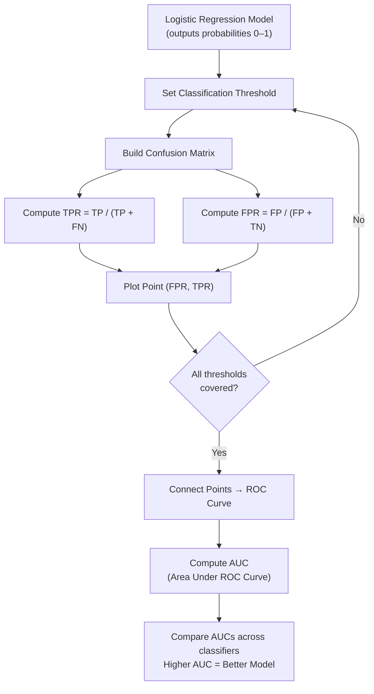

# ROC and AUC

> **Summary**: An ROC (Receiver Operating Characteristic) graph summarises all confusion matrices produced by sweeping a classification threshold from 0 to 1, plotting true positive rate (sensitivity) on the y-axis against false positive rate (1 − specificity) on the x-axis. The AUC (Area Under the Curve) collapses the entire curve into a single number, making it easy to compare classifiers — a higher AUC is better.

---

## 1. Core Technique Taught

### Overview & Concepts

- **Prerequisites stated by speaker**: Confusion matrix, sensitivity, specificity, and logistic regression basics are assumed. "This StatQuest builds on the confusion matrix and sensitivity and specificity StatQuests."
- **Motivating example**: Logistic regression predicting obesity in mice from weight. The y-axis of the logistic regression output is probability of being obese; converting probabilities to classifications requires a threshold.

#### The Classification Threshold Problem
- Default threshold: 0.5 — classify as obese if P(obese) > 0.5.
- Lowering the threshold (e.g., to 0.1) catches more true positives but also increases false positives.
- Raising the threshold (e.g., to 0.9) reduces false positives but may miss true positives.
- **Key insight**: "The threshold could be set to anything between zero and one. How do we determine which threshold is the best?"
- Ebola analogy (from the video): If misclassifying an infected person is catastrophic, you lower the threshold even if it means more false positives.

#### Building the ROC Curve (step-by-step as described)
For each candidate threshold:
1. Generate a confusion matrix.
2. Calculate **True Positive Rate (TPR)** = TP / (TP + FN) — same as sensitivity. Answers: "What proportion of actually-positive samples were correctly classified?"
3. Calculate **False Positive Rate (FPR)** = FP / (FP + TN) — same as 1 − specificity. Answers: "What proportion of actually-negative samples were incorrectly classified as positive?"
4. Plot the point (FPR, TPR).
5. Connect all points → the ROC curve.

**Anchor points**:
- Threshold so low that everything is classified positive → point at (1, 1).
- Threshold so high that everything is classified negative → point at (0, 0).
- The green diagonal from (0,0) to (1,1) is the "random classifier" line — any point above/left of it is better than random.

#### Reading the ROC curve
- A point to the **left** of the diagonal means TPR > FPR — the threshold is better than chance.
- "Without having to sort through the confusion matrices, I can tell that this threshold is better than this threshold."
- The optimal threshold depends on how many false positives you are willing to accept.

#### AUC (Area Under the Curve)
- Collapses the full ROC curve into one scalar.
- "The AUC makes it easy to compare one ROC curve to another. The AUC for the red ROC curve is greater than the AUC for the blue ROC curve, suggesting that the red curve is better."
- Example: if logistic regression has a higher AUC than random forest, you choose logistic regression.

#### Precision-Recall alternative (mentioned in video)
- Some practitioners replace FPR on the x-axis with **Precision** = TP / (TP + FP).
- Precision is "the proportion of positive results that were correctly classified."
- Use case: "If there were lots of samples that were not obese relative to the number of obese samples, then precision might be more useful than the false positive rate." The speaker's explanation: precision is not affected by class imbalance because it does not include the number of true negatives in its calculation. This is relevant "when studying a rare disease."

### Workflow Diagram

---

## 2. Code Patterns Shown

No code shown in this video — conceptual explanation only.

---

## 3. Key Warnings & Gotchas

- **Many thresholds share the same confusion matrix**: The speaker explicitly notes that some thresholds "result in the exact same confusion matrix" — you do not need to test every value between 0 and 1.
- **The diagonal is the random-classifier baseline**: Any ROC point on the green diagonal (where TPR = FPR) means the model is performing no better than random guessing. Better classifiers push the curve toward the upper-left corner.
- **FPR vs. Precision tradeoff**: False positive rate can be misleading when classes are severely imbalanced (e.g., rare diseases with many more negatives than positives). In those cases, replacing FPR with Precision on the x-axis (Precision-Recall curve) is more informative because precision excludes true negatives.
- **AUC comparison is between whole curves, not individual thresholds**: AUC tells you which overall model is better; it does not directly tell you which threshold to use in deployment.
