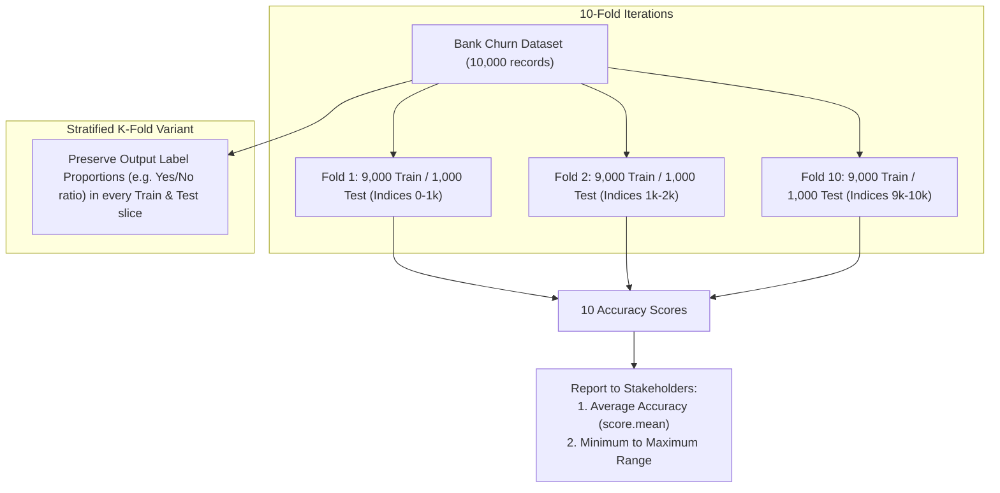

# Train Test Split vs K-Fold vs Stratified K-Fold Cross Validation

> **Summary**: While a standard train-test split causes model accuracy to fluctuate depending on the arbitrary `random_state`, K-Fold cross-validation provides an aggregated mean and realistic performance range (min to max) across multiple experiments. For imbalanced datasets, Stratified K-Fold ensures each fold maintains an equal proportion of class labels across training and testing splits.

---

## 1. Core Technique Taught

### Overview & Concepts
- **Problem Setup**: Predicting customer churn using a bank customer churn modeling dataset (10,000 records) to determine whether a customer will leave the bank, evaluated using an XGBoost classifier (`XGBClassifier`) tuned via `RandomizedSearchCV`.
- **Technique Comparison**:
  1. **Train-Test Split**:
     - Splits data into fixed training and test sets (e.g., 70% train / 30% test).
     - **Issue**: Changing the `random_state` parameter (e.g., from default to `0` to `200`) alters the randomly sampled records, causing the measured accuracy score to fluctuate (e.g., from 86% to 86.6% to 85%). In larger datasets with millions of records, this variance can be substantial.
  2. **K-Fold Cross-Validation (`cross_val_score`)**:
     - Performs \(K\) distinct experiments across the dataset.
     - For 10,000 records with \(K=10\), each fold allocates 1,000 records to test and 9,000 records to train, rotating so that every 1,000-record block serves as the test set once.
     - Yields an array of 10 individual accuracy scores.
     - **Stakeholder Reporting**: Rather than reporting a single volatile accuracy number, calculate `score.mean()` for average accuracy, and report the operational bounds: the minimum accuracy (e.g., 0.852) and maximum accuracy (e.g., 0.878).
  3. **Stratified K-Fold Cross-Validation (`StratifiedKFold`)**:
     - Necessary when working with imbalanced classification datasets (e.g., 1,000 records containing 600 "Yes" and 400 "No" labels).
     - Ensures that in every fold, the training and testing sets maintain the correct proportions of target output labels rather than drawing an unbalanced distribution by chance.

### Workflow Diagram



---

## 2. Code Patterns Shown

The following code implementations were explicitly written, executed, and explained in the video:

### 1. Train-Test Split with Random State Variance
```python
from sklearn.model_selection import train_test_split
from sklearn.metrics import confusion_matrix, accuracy_score

# Changing random_state demonstrates accuracy score fluctuations
X_train, X_test, y_train, y_test = train_test_split(X, y, test_size=0.30, random_state=0)

classifier.fit(X_train, y_train)
prediction = classifier.predict(X_test)

cm = confusion_matrix(prediction, y_test)
acc = accuracy_score(prediction, y_test)
```

### 2. K-Fold Cross-Validation & Stakeholder Metrics
```python
from sklearn.model_selection import cross_val_score

# 10 experiments across independent features X and dependent feature y
score = cross_val_score(classifier, X, y, cv=10)

# Reporting performance to stakeholders:
print("Scores array:", score)
print("Average Accuracy:", score.mean())
print("Lowest Accuracy:", score.min())
print("Maximum Accuracy:", score.max())
```

### 3. Stratified K-Fold Manual Split Loop
```python
from sklearn.model_selection import StratifiedKFold
from sklearn.metrics import accuracy_score
import numpy as np

skf = StratifiedKFold(n_splits=10)
accuracy = []

for train_index, test_index in skf.split(X, y):
    x1_train, x1_test = X.iloc[train_index], X.iloc[test_index]
    y1_train, y1_test = y.iloc[train_index], y.iloc[test_index]
    
    classifier.fit(x1_train, y1_train)
    prediction = classifier.predict(x1_test)
    score = accuracy_score(prediction, y1_test)
    accuracy.append(score)

# Convert list to NumPy array to compute mean
mean_accuracy = np.array(accuracy).mean()
print("Stratified K-Fold Mean Accuracy:", mean_accuracy)
```

---

## 3. Key Warnings & Gotchas

- **Train-Test Split Randomness Trap**: Accuracy varies each time `random_state` changes because train and test sets are sampled randomly. Never rely on a single train-test split for real-world stakeholder reporting.
- **Reporting to Stakeholders**: When communicating model performance to business stakeholders, do not provide an isolated single-split number. Provide the average accuracy along with the lowest and highest accuracy range observed across folds.
- **Imbalanced Dataset Failure**: When target classes are imbalanced, standard K-Fold cross-validation may create folds with disproportionate class distributions. Use `StratifiedKFold` so that every training and test partition maintains a balanced ratio of each class label.
- **Python List `.mean()` AttributeError**: A standard Python `list` does not have a `.mean()` method (`AttributeError: 'list' object has no attribute 'mean'`). Wrap the accuracy list in `np.array(accuracy).mean()` to compute the mean.
